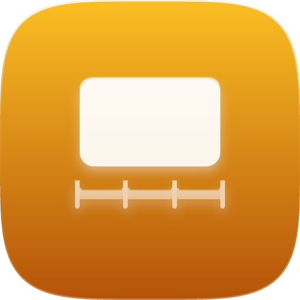

<p align="center">
  <picture>
    <source media="(prefers-color-scheme: dark)" srcset="brand/app-icon-dark.png">
    
  </picture>
</p>

<p align="center">
  <picture>
    <source media="(prefers-color-scheme: dark)" srcset="brand/logo/slide-sync-skill-wordmark-white.svg">
    
  </picture>
</p>

<p align="center"><b>Slide changes in a talk, as a timeline and chapters</b></p>

Slide changes in a talk recording, as a slide timeline and chapters. Part of the [AI Video Production OS](https://github.com/kajisho5/AI-video-production-OS) (department 認識 / Recognition).

Typical use: a conference or lecture recording from the presenter's screen feed. `detect` finds where each slide starts. `chapters` turns that into the YouTube description's chapter list and, if you want, a copy of the video with chapters a player can seek by. `import` turns the speaker's deck (PDF, or PPTX / KEY through LibreOffice) into one image and one text per page. `match` says which page of that deck is on screen in each detected slide, in whatever order the speaker showed them. `insert` splices a clip (a demo video, the video a slide embeds, a still) in at a slide boundary, with the timeline and chapters shifted to match. `layout` frames the talk for the archive from `match` and a speaker camera: the slide with the speaker picture-in-picture (or beside a pillarboxed slide) while a deck page is up, the speaker full frame before the talk and during Q&A, as a plan of ffmpeg-skill `overlay` / `broll` calls that it can also render. `clean` puts the deck page, sharp, over a soft camera shot of the projection wherever `match` is confident, and leaves everything else as captured.

```bash
pip install -e .
export FFMPEG_SKILL_DIR=/path/to/ffmpeg-skill   # or ~/.claude/skills/ffmpeg-skill, ../ffmpeg-skill
slide-sync doctor
slide-sync detect talk.mp4 --sheet sheet.png -o timeline.json
slide-sync detect recording.ts --follow --json --chapters-out chapters.txt -o timeline.json   # while it records
slide-sync chapters talk.mp4 --timeline timeline.json --titles titles.txt --min-chapter 10 \
    --chapters-out chapters.txt -o talk_chapters.mp4

pip install -e '.[pdf]'                          # slide import (pypdfium2); PPTX / KEY also need LibreOffice
slide-sync import deck.pdf -o pages/             # pages/page-001.png, page-001.txt, ..., deck.json
slide-sync match talk.mp4 --deck pages/ --timeline timeline.json -o match.json
slide-sync insert talk.mp4 --timeline timeline.json --insert 3=demo.mp4 --insert 5=pages/page-006.png \
    --insert-title Demo --titles titles.txt -o talk_demo.mp4 --timeline-out talk_demo.json
slide-sync layout talk.mp4 --match match.json --camera speaker.mp4 --plan-out layout.json -o talk_layout.mp4
slide-sync clean camera.mp4 --match match.json --plan-out clean.json -o camera_clean.mp4
```

`chapters.txt` (also in the JSON as `text`):

```
0:00 はじめに
2:15 背景
5:40 方法
```

## How it works

- **Detection.** [ffmpeg-skill](https://github.com/kajisho5/ffmpeg-skill) `scenes` finds picture cuts with ffmpeg's `scdet`. Cuts closer than `--min-dwell` seconds (default 2) are ignored, so a slide counts only if it stays up. `--threshold` (default 8, 0-100) sets how strong a cut must be. `--sheet` writes one thumbnail per detected slide, so you can check the result at a glance.
- **While it records.** `detect --follow` watches a recording the recorder is still writing. Every `--poll` seconds (default 5), if the file has grown, ffmpeg-skill `scenes` reads it as it stands. A slide change is printed as a JSON line once it is at least `--min-dwell` + 1 s before the end of what could be read: from that point on, it is the change the finished file will have. When the file has not changed for `--settle` seconds (default 30), one batch `detect` gives the timeline and the last changes. A change reported earlier that the batch run does not have is retracted, not hidden. `--chapters-out` is rewritten at every change, so the chapters are ready when the recording closes. Changes come while recording only for MPEG-TS (`.ts`, `.m2ts`, `.mts`), whose length ffmpeg-skill can measure while it grows. For an MKV or MP4 written live they come at close. Why: [docs/decisions.md](docs/decisions.md) ADR-007.
- **Chapters.** There is one chapter per slide, titled from `--titles` in order (then `Slide N`). `--min-chapter` merges short slides into the chapter before them. Warnings say when the list breaks YouTube's chapter rules: at least 3 chapters, the first at 0:00, each at least 10 s.
- **Writing.** ffmpeg-skill `metadata` writes the chapters into a copy (`-o`), with streams copied bit for bit. The input is never written. An existing output needs `--overwrite`.

- **Import.** [pypdfium2](https://github.com/pypdfium2-team/pypdfium2) (PDFium; Apache-2.0 OR BSD-3-Clause) renders every page of a PDF and reads its text layer. A `.pptx`, `.ppt`, `.key` or `.odp` deck is first converted to PDF by LibreOffice (`soffice --headless --convert-to pdf`, on a copy of the deck, with a throwaway profile); without LibreOffice that is a `DEPENDENCY_MISSING` error. Pages are rendered at a fixed **144 dpi** by default (`--dpi`, 18-600): a 16:9 PowerPoint slide (960 x 540 pt) becomes 1920 x 1080 px, in general `ceil(points x dpi / 72)`. Output is deterministic: 8-bit RGB PNG with no metadata, and the same text normalisation every time (line ends, Unicode NFC, Kangxi-radical look-alikes such as `⽇` folded to `日`). `deck.json` (`slide-sync/deck@1`) lists every page with its size, text and PNG sha256. Why these engines (PyMuPDF and Ghostscript are AGPL, Poppler is GPL): [docs/decisions.md](docs/decisions.md) ADR-001.

- **Match.** For each slide of the timeline, three frames (at 1/4, 1/2 and 3/4 of it) come from ffmpeg-skill `look`. Each frame and each page becomes a grid of mean brightness. A frame is compared as a whole (screen capture), with the page's aspect fitted (letterbox / pillarbox), and, when the slide sits inside a uniform surround (black bars, a dark room), as the quadrilateral found there, straightened (a camera's keystone, a small tilt). Brightness and contrast are normalised, the deck's average page is subtracted (so a shared template does not make every page look alike), and the score is the correlation, 0 to 1, median over the frames. A segment gets a page only when its score is at least **0.7** (`--min-score`) and at least **0.1** ahead of the next page (`--min-margin`); otherwise `page` is `null` with the reason (`below_min_score`, `ambiguous`). Frames of one slide that show different pages are flagged `mixed` (a change `detect` missed). Method, thresholds and what they were measured on: [docs/decisions.md](docs/decisions.md) ADR-002.

- **Insert.** `--insert N=CLIP` puts a clip after slide N of the timeline (0: before slide 1); repeat it for more. ffmpeg-skill does the media work: `probe` measures the recording and each video clip, `insert` turns an image into a still clip of `--still-duration` seconds (default 5) at the recording's size and frame rate, `cut --accurate` splits the recording at each boundary, `join --transition none` puts parts and clips together at the recording's size and rate (other sizes padded, a clip without sound gets silence), and `metadata` writes the chapters. Every slide after a clip moves later by the clip's measured length, and each clip gets a chapter of its own (`--insert-title`, or its file name). `--timeline-out` writes the shifted timeline: `slide-sync/timeline@1` with `provenance: DERIVED`, `derived_from`, `edits` (where each clip went, its length and sha256) and `render` (each ffmpeg-skill step and the measured drift from the predicted length). Why it works this way: [docs/decisions.md](docs/decisions.md) ADR-003.

- **Layout.** From a match (`--match`, or `--deck` to match now) and a speaker camera on the recording's clock (`--camera`, `--camera-offset`), every segment gets a layout and the rule that chose it: `slide_pip` while a deck page is on screen (the camera in a corner, `--pip-position`, `--pip-width` 25 % of the frame), `side_by_side` instead when the slide is pillarboxed and leaves a free band of at least 12 % of the frame width at the side (a 4:3 deck in a 16:9 capture; the camera goes in the band, the slide is not covered), `speaker_full` before the first and after the last matched page (the talk not started yet, Q&A) and from `--qa-from` on, `slide_full` with `--slides full` or without a camera. An unmatched segment between matched pages (a demo, a backup slide, a blank) keeps the slide picture, or goes to the speaker with `--unmatched speaker`. Where the camera does not cover the recording, the slide picture is kept. The plan (`slide-sync/layout@1`, `--plan-out`) lists the ffmpeg-skill calls: one `overlay --video --place` per corner or band, then one `broll` for the speaker-full spans; `-o` runs them, keeping the recording's sound throughout. Rules and why: [docs/decisions.md](docs/decisions.md) ADR-005.

- **Clean.** For every segment of a match: `replace` when a page matched with at least `--min-confidence` (0.8, above match's own 0.7) and the segment's frames agree, otherwise `keep` (`low_confidence`, `mixed`, `unmatched`). Each replaced page becomes a still clip at the recording's frame size (aspect kept, padded with `--pad-color`) through ffmpeg-skill `insert`, and one `broll` puts the clips over their spans, keeping the recording's sound. The plan is `slide-sync/clean@1` (`--plan-out`); `-o` renders it. Why: [docs/decisions.md](docs/decisions.md) ADR-006.

This skill never runs ffmpeg or ffprobe itself: ffmpeg-skill is its only media boundary. `detect`, `chapters` and `match` need nothing beyond the Python standard library; `import` needs the optional `pdf` extra (and LibreOffice for non-PDF decks). Nothing makes network access.

## Commands

| Command | What it does |
|---|---|
| `detect <video> [--threshold 8] [--min-dwell 2] [--sheet png] [--chapters-out txt] [-o timeline.json]` | Slide timeline (`slide-sync/timeline@1`): slides with start, end and duration, change times, detector settings, engine version |
| `detect <video> --follow [--settle 30] [--poll 5] [--follow-for s] [--chapters-out txt] [-o timeline.json]` | The same for a recording still being written. JSON lines (`start`, `pass`, `waiting`, `change`, `retract`, `done` with the timeline) |
| `chapters <video> [--timeline json] [--titles txt] [--prefix Slide] [--min-chapter s] [--chapters-out txt] [-o video]` | Chapters from a timeline. Without `--timeline` it runs `detect` first |
| `import <deck> -o <dir> [--dpi 144] [--soffice path] [--overwrite]` | `<dir>/page-NNN.png`, `page-NNN.txt` and `deck.json` for a `.pdf`, or a `.pptx` / `.ppt` / `.key` / `.odp` when LibreOffice is installed. Only those names are written; existing ones need `--overwrite` |
| `match <video> --deck <dir> [--timeline json] [--min-score 0.7] [--min-margin 0.1] [--samples 3] [-o match.json]` | Match timeline (`slide-sync/match@1`): for every slide, start, end, deck `page` (or `null` and the `reason`), `confidence`, `margin` over the runner-up, `method`, `view`, per-frame pages, top candidates; `pages_shown`, `pages_not_shown`, `warnings`. Without `--timeline` it runs `detect` first |
| `insert <video> --insert N=CLIP [--insert ...] [--insert-title T ...] [--still-duration 5] [--timeline json] [--titles txt] [--prefix Slide] [--min-chapter s] [--chapters-out txt] [--timeline-out json] -o <video>` | A copy of the video with clips spliced in after slides N (0: at the start) and the shifted chapters written in. Without `--timeline` it runs `detect` first |
| `layout <video> (--match json \| --deck dir [--timeline json]) [--camera video] [--camera-offset 0] [--qa-from s] [--slides auto\|pip\|side\|full] [--unmatched keep\|speaker] [--pip-position bottom-right] [--pip-width 25] [--plan-out json] [-o video]` | Layout plan (`slide-sync/layout@1`): per segment the `layout` and the `rule` (and `why`), merged `spans`, and the ffmpeg-skill `overlay` / `broll` `steps` in order; `-o` renders it |
| `clean <video> (--match json \| --deck dir [--timeline json]) [--deck dir] [--min-confidence 0.8] [--pad-color black] [--plan-out json] [-o video]` | Clean-pages plan (`slide-sync/clean@1`): per segment `replace` or `keep` and the `rule`, the replaced `spans`, the ffmpeg-skill `insert` / `broll` `steps`; `-o` renders it |
| `contract --json` | Machine-readable contract in the OS registry's shape |
| `doctor --json` | Python, ffmpeg-skill location and version, ffmpeg / ffprobe, and whether `scenes` / `metadata` / `look` are usable (and, for `insert`, `probe` / `cut` / `insert` / `join`, as a note); for import, pypdfium2 and LibreOffice with their install lines (a missing one is a note, not a failure) |

Every command prints one JSON document with `--json`. Exit codes: 0 ok, 2 invalid input or arguments (including a file PDFium cannot open, or a deck directory without `deck.json`), 3 ffmpeg-skill, pypdfium2 or LibreOffice missing (or ffmpeg-skill lacking a tool), 4 ffmpeg-skill or LibreOffice failed.

## Limits

- It works best on a screen feed (capture of the presentation PC, a switcher program out, a Zoom recording of a shared screen).
- A camera filming a projector also cuts on camera moves, people walking in front, and re-framing. Raise `--min-dwell`, and check the sheet.
- Animated builds and videos inside a slide can count as changes.
- `import` reads the text layer of the deck. A scanned or image-only page has no text layer and gets empty text; reading text from pixels (OCR) is detection-skill's job.
- PPTX / KEY rendering is LibreOffice's: fonts the deck uses but the machine lacks are substituted, so check the PNGs (or export the PDF from PowerPoint / Keynote yourself).
- `match` compares pictures, not text. A slide that is not in the imported deck, a blanked projector, two identical pages, a person standing in front of the slide, or a camera zoomed into part of it give `page: null`, by design. Something that crosses the slide's edge or a surround that is not uniform (stage lights, heads at the bottom of the frame) defeats the straightening; then only a near-full-frame shot still matches. Details and measurements: ADR-002.
- `insert` re-encodes the talk (twice: the cut and the join), pads clips of another aspect ratio, and places clips only between slides. Anything finer is editing (video-editing-skill).
- `layout` does not sync the camera to the recording (give `--camera-offset`; ffmpeg-skill `multicam` / `sync` measure it), does not move or shrink the slide for side by side (only a free band beside a pillarboxed slide is used), and works on recorded files, not a live switch. Rendering re-encodes the talk once per step (at most one `overlay` per corner / band and one `broll`).
- `detect --follow` reads the whole written part again on every pass, so a long recording needs a larger `--poll`. Whether the recorder still has the file open is not detected: `--settle` seconds without a change counts as closed.
- `clean` shows only what is on the deck page: a laser pointer, live annotations or a video playing inside the slide disappear in a replaced span. Animated builds matched to the full page show the full page early.

## Tests

```bash
python -m unittest -v tests/test_slide_sync.py
```

The integration tests run the real ffmpeg-skill on generated slide decks. They are skipped when ffmpeg-skill or ffmpeg is not found. The import tests build their PDF (English and Japanese pages) and PPTX at test time; they need `pip install -e '.[pdf]'`, and the real-LibreOffice test also needs `soffice`. The match unit tests draw their pages and frames in Python. The shuffled-slides test imports a generated deck, films it with ffmpeg out of order (with a slide that is not in the deck and a blanked projector), as a screen capture and as a keystoned camera shot, and checks every segment's page; it needs ffmpeg-skill, ffmpeg and pypdfium2. The insert unit tests check the timeline shift and fake ffmpeg-skill; the insert integration test splices a generated demo clip and a still into a generated talk with the real ffmpeg-skill and checks the output's chapters and the picture in every segment. The layout unit tests assign layouts to faked match documents and check every rule and ffmpeg-skill argument; the layout integration test (three deck pages, then Q&A on a blanked projector, and a speaker camera) imports, detects, matches, plans and renders with the real ffmpeg-skill and checks the PiP on every slide and the speaker full frame in the Q&A. The clean unit tests decide replace / keep on faked match documents; the clean integration test films three deck pages and a slide that is not in the deck with a soft, keystoned, noisy simulated camera, cleans it with the real ffmpeg-skill, and checks that replaced frames are sharper than the capture and the unmatched span is unchanged. The follow unit tests grow a file under a fake clock; the follow integration test appends a real MPEG-TS recording to its file in ten bursts while `detect --follow` runs, and checks that it reports the batch run's changes, most of them while the file still grows.

## License

MIT
